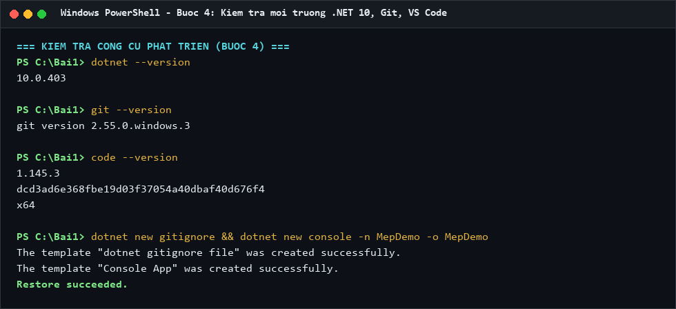
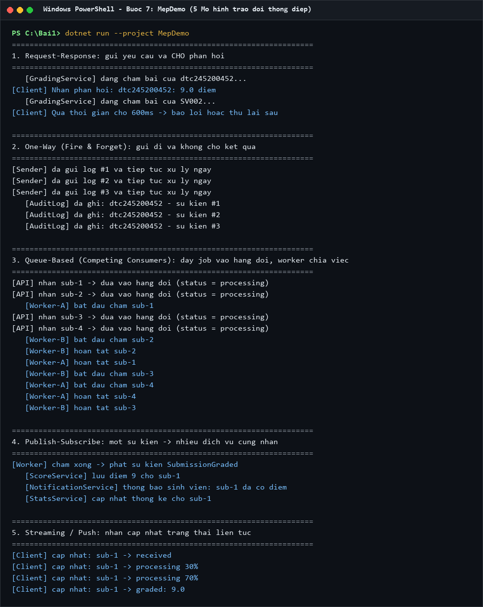
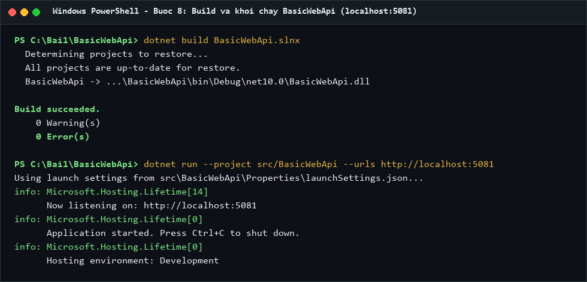
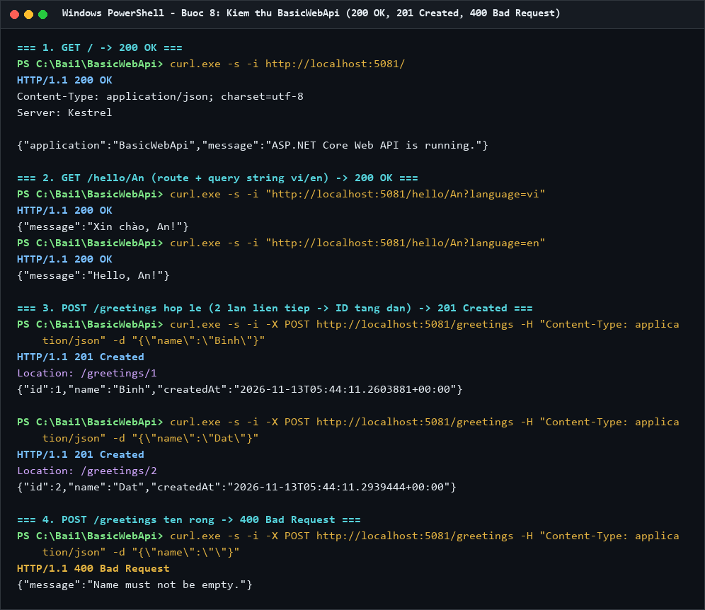
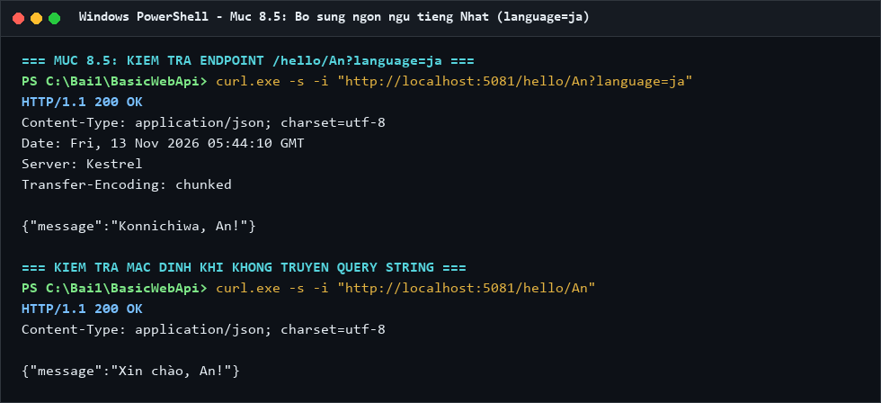
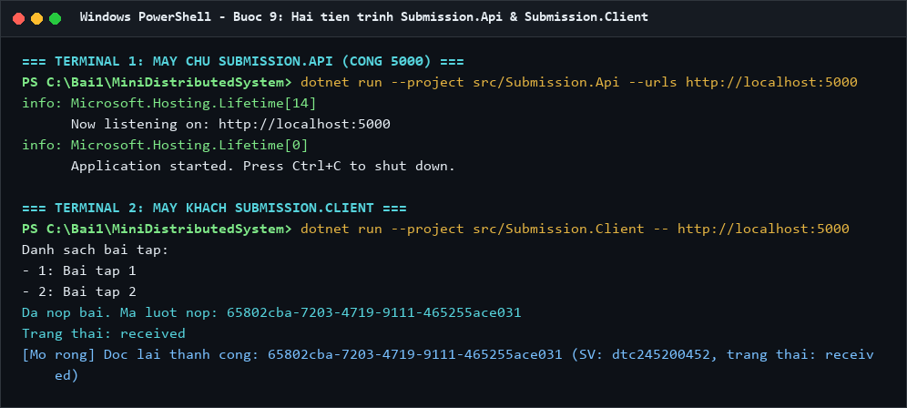
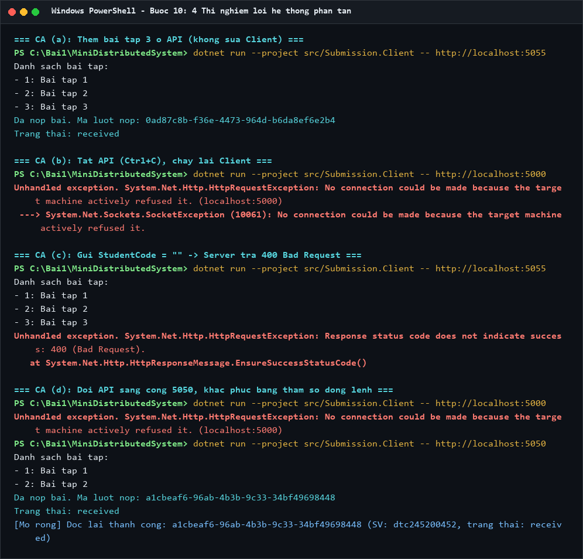
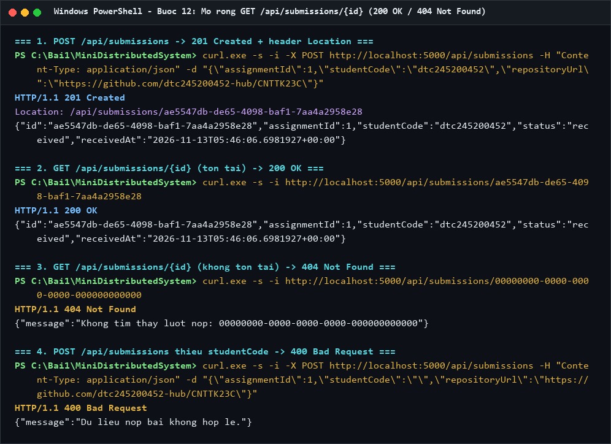

# Bài 1 – Tổng quan hệ thống và các mô hình trao đổi thông điệp (MEP)

- **Họ và tên:** Nguyễn Tuấn Đạt
- **MSSV:** `dtc245200452`
- **Lớp:** CNTT K23C
- **Học phần:** Phát triển ứng dụng phân tán – GV: TS. Dương Thu Mây
- **Môi trường thực hành:** Windows 11 64-bit, .NET SDK `10.0.403`, Git `2.55.0.windows.3`, VS Code `1.145.3`

> Ảnh minh chứng trong tài liệu được kết xuất trực tiếp từ đầu ra thật khi biên dịch và chạy các chương trình trên máy.

---

## 1. Cài đặt môi trường (Bước 1–4)

Kiểm tra các công cụ phát triển trên máy:
- `dotnet --version` → `10.0.403`
- `git --version` → `git version 2.55.0.windows.3`
- `code --version` → `1.145.3`
- Khởi tạo `.gitignore` chuẩn .NET (`dotnet new gitignore`) để loại trừ `bin/`, `obj/`, `.vs/` khỏi lịch sử Git.



---

## 2. MepDemo – Khảo sát 5 mô hình trao đổi thông điệp (Bước 7)

Chương trình `MepDemo` mô phỏng 5 mô hình MEP trong cùng một tiến trình bằng `System.Threading.Channels` và `IAsyncEnumerable<string>`.



### Trả lời 3 câu hỏi Bước 7:

1. **Ở MEP 3 (Queue-based), mỗi bài nộp `sub-x` được mấy worker xử lý?**
   - **Trả lời:** Mỗi bài nộp chỉ được **đúng 1 worker duy nhất** xử lý (trong lần chạy thực nghiệm: `Worker-A` chấm `sub-1`, `sub-4`; `Worker-B` chấm `sub-2`, `sub-3`).
   - **Giải thích:** Đây là mô hình *Competing Consumers*. Cả hai worker cùng đọc từ một `Channel.CreateBounded<GradeJob>` chung; khi một worker lấy `sub-x` ra khỏi hàng đợi thì thông điệp đó không còn nằm trong hàng đợi để worker khác lấy nữa, giúp chia tải và tránh chấm trùng.

2. **Ở MEP 4 (Publish–Subscribe), một sự kiện được gửi tới mấy dịch vụ?**
   - **Trả lời:** Một sự kiện `SubmissionGraded` được gửi tới **cả 3 dịch vụ** đã đăng ký với `InMemoryEventBus`: `ScoreService`, `NotificationService` và `StatsService`.
   - **Giải thích:** Bên phát (*Publisher*) chỉ phát sự kiện lên bus chung mà không cần biết danh sách bên nhận cụ thể; mọi bên đăng ký (*Subscribers*) đều nhận được bản sao của sự kiện để xử lý độc lập.

3. **Mỗi MEP một câu mô tả:**
   - **MEP 1 (Request–Response):** Bên gửi phát yêu cầu và chờ bên nhận xử lý trả về kết quả (hoặc xử lý hết thời gian chờ `TimeoutException`).
   - **MEP 2 (One-Way / Fire & Forget):** Bên gửi đẩy thông điệp đi và tiếp tục công việc ngay lập tức mà không chờ phản hồi nghiệp vụ từ bên nhận.
   - **MEP 3 (Queue-Based):** Hàng đợi trung gian lưu đệm tác vụ và phân phối cho nhiều worker chạy song song, mỗi tác vụ chỉ do một worker xử lý.
   - **MEP 4 (Publish–Subscribe):** Một sự kiện được phát ra và chuyển đồng loạt tới tất cả các dịch vụ đang đăng ký lắng nghe loại sự kiện đó.
   - **MEP 5 (Streaming / Push):** Dữ liệu cập nhật được máy chủ đẩy liên tục qua luồng (`IAsyncEnumerable`) theo thời gian thực mà client không cần gửi yêu cầu thăm dò lặp lại.

---

## 3. BasicWebApi – Luyện kỹ thuật Minimal API (Bước 8 / Thực hành 1.2)

### 3.1. Build và chạy BasicWebApi

Khởi tạo solution `BasicWebApi.slnx` và project `src/BasicWebApi` theo template `webapi --no-openapi`, biên dịch (`0 Warning(s), 0 Error(s)`) và lắng nghe tại `http://localhost:5081`.



### 3.2. Kiểm thử endpoint: 200 OK, 201 Created, 400 Bad Request

| Phương thức & URI | Dữ liệu gửi | Kỳ vọng | Thực tế | Minh họa |
|---|---|---|---|---|
| `GET /` | – | `200 OK` | `200 OK`, JSON `{"application":"BasicWebApi","message":"ASP.NET Core Web API is running."}` | Xác nhận API đang chạy |
| `GET /hello/An?language=vi` | – | `200 OK` | `200 OK`, `{"message":"Xin chào, An!"}` | Đọc `name` từ route, `language` từ query |
| `GET /hello/An?language=en` | – | `200 OK` | `200 OK`, `{"message":"Hello, An!"}` | Nhánh tiếng Anh |
| `GET /hello/An` | – | `200 OK` | `200 OK`, `{"message":"Xin chào, An!"}` | Mặc định khi thiếu query `language` |
| `POST /greetings` | `{"name":"Binh"}` | `201 Created` | `201 Created`, `Location: /greetings/1`, `id: 1` | Tạo mới với `GreetingService` |
| `POST /greetings` (lần 2) | `{"name":"Dat"}` | `201 Created` | `201 Created`, `Location: /greetings/2`, `id: 2` | `Interlocked.Increment` tăng ID trong RAM |
| `POST /greetings` | `{"name":""}` | `400 Bad Request` | `400 Bad Request`, `{"message":"Name must not be empty."}` | Handler chặn tên rỗng |
| `POST /greetings` | `{}` | `400 Bad Request` | `400 Bad Request`, `{"message":"Name must not be empty."}` | Thiếu trường `name` → `null` |



### 3.3. Trả lời câu hỏi Mục 8.4

1. **Hai dòng `builder.Services.AddSingleton<GreetingService>()` và `var app = builder.Build();`, dòng nào phải đứng trước? Vì sao?**
   - Dòng `builder.Services.AddSingleton<GreetingService>();` **phải đứng trước** `var app = builder.Build();`.
   - `Program.cs` gồm 2 pha: Pha 1 khai báo dịch vụ vào `IServiceCollection` (`builder.Services`), Pha 2 gọi `builder.Build()` để đóng băng danh sách dịch vụ và tạo đối tượng `WebApplication` (`IServiceProvider`). Nếu đăng ký sau `Build()`, tập hợp dịch vụ đã ở trạng thái chỉ đọc (`read-only`), không thể thêm dịch vụ mới cho DI container.

2. **Trong `/hello/{name}?language=en`, tham số `name` lấy từ đâu, `language` lấy từ đâu?**
   - `name` lấy từ **route parameter** tại vị trí `{name}` trong mẫu đường dẫn `/hello/{name}`.
   - `language` lấy từ **query string** nằm sau dấu `?` trên URL (`?language=en`).

3. **Vì sao POST hợp lệ trả `Results.Created` (201) chứ không phải `Results.Ok` (200)?**
   - Theo ngữ nghĩa HTTP, `200 OK` chỉ báo yêu cầu thành công nói chung, còn `201 Created` xác nhận rõ ràng **một tài nguyên mới đã được tạo** trên máy chủ và trả kèm header `Location: /greetings/{id}` chỉ ra đường dẫn của tài nguyên vừa sinh.

### 3.4. Mục 8.5 – Thêm ngôn ngữ tiếng Nhật (`language=ja`)

Bổ sung nhánh kiểm tra `language=ja` (không phân biệt hoa/thường) trong `BasicWebApi/src/BasicWebApi/Program.cs`:

```csharp
app.MapGet("/hello/{name}", (string name, string? language) =>
{
    var message = string.Equals(language, "en", StringComparison.OrdinalIgnoreCase)
        ? $"Hello, {name}!"
        : string.Equals(language, "ja", StringComparison.OrdinalIgnoreCase)
            ? $"Konnichiwa, {name}!"
            : $"Xin chào, {name}!";

    return Results.Ok(new GreetingResponse(message));
});
```



### 3.5. Mục 8.6 & Vòng đời dịch vụ (Thực hành 1.2)

- **Quan sát dữ liệu và vòng đời `Singleton`:** Khi gửi hai `POST /greetings` liên tiếp trong cùng một tiến trình đang chạy, `GreetingService` giữ `_lastId` trong RAM nên phản hồi lần 1 có `id: 1`, lần 2 có `id: 2`. Khi dừng API (thử gọi `GET /` nhận lỗi `curl: (7) Failed to connect to localhost port 5081: Could not connect to server`) và khởi chạy lại, bộ đếm `_lastId` quay về `0` nên POST mới lại bắt đầu từ `id: 1` vì `Singleton` chỉ tồn tại trong vòng đời một tiến trình, không lưu bền vững ra đĩa/CSDL.
- **Đường đi dữ liệu khi debug:** Đặt breakpoint tại dòng `var greeting = service.Create(request.Name.Trim());` trong `BasicWebApi/src/BasicWebApi/Program.cs`. Trước khi bước qua dòng này (`F10`), biến `request.Name` chứa chuỗi đầu vào đã deserialize từ JSON body; sau khi bước qua, `greeting` nhận giá trị `StoredGreeting` gồm `Id`, `Name` đã `Trim()` và `CreatedAt` (UTC) trước khi `Results.Created(...)` trả JSON và header `Location`.
- **Vì sao sửa source phải build/chạy lại:** Mã C# được biên dịch thành IL/DLL trước khi nạp vào tiến trình .NET; tiến trình đang chạy vẫn thực thi bản DLL cũ trong bộ nhớ cho tới khi dừng, build lại (`dotnet build`) và khởi chạy lại (`dotnet run`).

---

## 4. MiniDistributedSystem – Hai tiến trình giao tiếp qua HTTP (Bước 9)

Hệ thống tách thành 2 project độc lập trong `MiniDistributedSystem.slnx`:
- **Terminal 1 (`Submission.Api`)**: Lắng nghe tại `http://localhost:5000`, cung cấp `GET /`, `GET /api/assignments`, `POST /api/submissions` và `GET /api/submissions/{id:guid}`.
- **Terminal 2 (`Submission.Client`)**: Nhận URL qua `args[0]`, gọi API bằng `HttpClient`, hiển thị danh sách bài tập, nộp bài cho `dtc245200452` và đọc lại lượt nộp vừa tạo.



### Trả lời 3 câu hỏi Bước 9:

1. **Client gọi những endpoint nào của API? Mỗi lần gọi gồm method, URL và mã trạng thái gì?**
   - Lần 1: `GET http://localhost:5000/api/assignments` → `200 OK` (nhận danh sách bài tập JSON).
   - Lần 2: `POST http://localhost:5000/api/submissions` → `201 Created` (kèm header `Location: /api/submissions/{id}` và đối tượng `SubmissionResult`).
   - Lần 3 (Mở rộng Bước 12): `GET http://localhost:5000/api/submissions/{id}` → `200 OK` (xác minh lại bản ghi vừa nộp).

2. **Client có tham chiếu (dùng chung) code của API không? Hai bên thống nhất bằng gì?**
   - **Không.** `Submission.Client.csproj` không có `<ProjectReference>` tới `Submission.Api`.
   - Hai bên thống nhất qua **hợp đồng giao tiếp HTTP + JSON** (route, phương thức HTTP, status code và cấu trúc các trường JSON). Mỗi bên tự khai báo bộ `record` riêng (`Assignment`, `CreateSubmissionRequest`, `SubmissionResult`) khớp tên trường theo quy ước JSON camelCase.

3. **Vì sao địa chỉ API truyền qua tham số `-- http://localhost:5000` mà không viết cứng trong code?**
   - Để tách biệt cấu hình khỏi mã nguồn (giảm ghép nối chặt). Khi máy chủ đổi cổng (ví dụ sang `5050`) hoặc triển khai lên máy/container khác, chỉ cần truyền lại tham số lúc chạy mà không phải sửa code và biên dịch lại Client.

---

## 5. Thí nghiệm lỗi (Bước 10)

Bảng tổng hợp 4 thí nghiệm thực tế trên `MiniDistributedSystem`:

| # | Thao tác | Dự đoán (trước khi chạy) | Kết quả thực tế | Đúng/Sai | Giải thích nguyên nhân |
|---|---|---|---|---|---|
| **a** | Thêm bài tập thứ 3 vào mảng `assignments` trên `Submission.Api`, chạy lại API (không sửa Client) | Client tự động in đủ 3 bài tập mà không cần sửa hay build lại Client | Client in đủ 3 bài tập: `- 1: Bai tap 1`, `- 2: Bai tap 2`, `- 3: Bai tap 3` và nộp bài thành công | **Đúng** | Client dùng `GetFromJsonAsync<List<Assignment>>("/api/assignments")` phân tích mảng JSON động theo hợp đồng không đổi; dữ liệu thay đổi trên server phản ánh ngay sang client. |
| **b** | Tắt `Submission.Api`, sau đó chạy `Submission.Client` | Client không kết nối được tới cổng `5000` và văng lỗi mạng | Ném `HttpRequestException: No connection could be made because the target machine actively refused it. (localhost:5000)` (`SocketException 10061`) | **Đúng** | Khác với gọi hàm nội bộ trong cùng tiến trình, lời gọi qua mạng phụ thuộc tiến trình máy chủ đang lắng nghe và đường truyền; khi server tắt, kết nối TCP bị từ chối ngay. |
| **c** | Sửa `StudentCode` thành `""` trong Client rồi gửi `POST /api/submissions` | API từ chối trả `400 Bad Request`; Client dừng ở `EnsureSuccessStatusCode()` | In được danh sách bài tập rồi dừng với `HttpRequestException: Response status code does not indicate success: 400 (Bad Request).` tại `EnsureSuccessStatusCode()` | **Đúng** | Máy chủ luôn phải tự kiểm tra dữ liệu đầu vào (*không tin dữ liệu từ mạng*). Phía Client dùng `EnsureSuccessStatusCode()` để ngăn tiếp tục đọc body thành công khi HTTP trả lỗi `4xx/5xx`. |
| **d** | Chạy `Submission.Api` ở cổng `5050`, Client vẫn gọi mặc định cổng `5000`, rồi sửa bằng tham số dòng lệnh | Gọi `5000` bị từ chối kết nối; truyền `-- http://localhost:5050` sẽ chạy thành công mà không sửa code | Gọi `5000` báo `actively refused it`; chạy `dotnet run --project src/Submission.Client -- http://localhost:5050` in danh sách bài tập và nộp bài thành công | **Đúng** | Client đọc `args[0]` làm `BaseAddress` của `HttpClient`, nên chỉ cần truyền địa chỉ mới qua tham số dòng lệnh là kết nối được sang cổng `5050`. |



---

## 6. Dự án EduSubmit tự làm và Bài mở rộng (Bước 11–12)

### 6.1. Thành phần đã triển khai mở rộng
- Trong `Submission.Api/Program.cs`:
  - Sử dụng `ConcurrentDictionary<Guid, SubmissionResult>` để lưu trữ an toàn các lượt nộp trong bộ nhớ tiến trình.
  - Bổ sung endpoint `GET /api/submissions/{id:guid}`: trả về `200 OK` kèm thông tin `SubmissionResult` nếu tồn tại, hoặc `404 Not Found` (`{"message":"Khong tim thay luot nop: ..."}`) nếu không tìm thấy.
- Trong `Submission.Client/Program.cs`:
  - Sau khi `POST /api/submissions` nhận `201 Created`, Client đọc URI từ header `Location` và gọi tiếp `GET /api/submissions/{id}` để xác nhận dữ liệu đã lưu trên server.



### 6.2. Sơ đồ luồng thông điệp

```text
Submission.Client                                          Submission.Api (localhost:5000)
        |                                                               |
        |--- GET /api/assignments ------------------------------------->|  (Request-Response: 200 OK)
        |<-- 200 OK [Assignment 1, Assignment 2] -----------------------|
        |                                                               |
        |--- POST /api/submissions (dtc245200452) --------------------->|  (Request-Response: validate & luu RAM)
        |<-- 201 Created + Location: /api/submissions/{id} -------------|
        |                                                               |
        |--- GET /api/submissions/{id} -------------------------------->|  (Request-Response - Buoc 12)
        |<-- 200 OK (hoac 404 Not Found neu ID khong ton tai) ----------|
```

### 6.3. Phần tham khảo từ tài liệu và ví dụ mẫu
- Toàn bộ solution `BasicWebApi.slnx`, `MiniDistributedSystem.slnx`, `MepDemo` được tự khởi tạo lại bằng lệnh `dotnet new` và tự viết lại trên .NET 10 cho MSSV `dtc245200452`.
- Tham khảo cấu trúc hợp đồng JSON (`Assignment`, `CreateSubmissionRequest`, `SubmissionResult`) và các kịch bản câu hỏi từ giáo trình Chương 1, hướng dẫn Thực hành 1.2 và bài ví dụ trong repository lớp.

---

## 7. Khó khăn gặp phải và cách giải quyết

1. **Lỗi escape dấu nháy JSON khi dùng `curl.exe` trên Windows PowerShell:**
   - *Nguyên nhân:* PowerShell xử lý dấu ngoặc kép khác với bash nên truyền `-d '{"name":"Binh"}'` có thể làm mất dấu nháy kép trong JSON, khiến server báo `400 Bad Request`.
   - *Cách giải quyết:* Escaping bằng `\"` trong nháy đơn `'{\"name\":\"Binh\"}'` hoặc dùng tệp `requests.http` của VS Code REST Client để gửi body JSON chuẩn xác.
2. **Xử lý đồng thời danh sách bài nộp khi mở rộng Bước 12:**
   - *Nguyên nhân:* `List<T>` thông thường không an toàn khi nhiều request đồng thời ghi/đọc trên cùng tiến trình API.
   - *Cách giải quyết:* Chuyển sang `ConcurrentDictionary<Guid, SubmissionResult>` trong `Submission.Api` để truy xuất theo `Guid` vừa nhanh (`O(1)`) vừa an toàn luồng.
3. **Tránh đưa thư mục `bin/` và `obj/` vào Git:**
   - *Cách giải quyết:* Tạo file `.gitignore` bằng `dotnet new gitignore` ngay từ bước khởi tạo trước khi `git add` và kiểm tra lại bằng `git status`.
